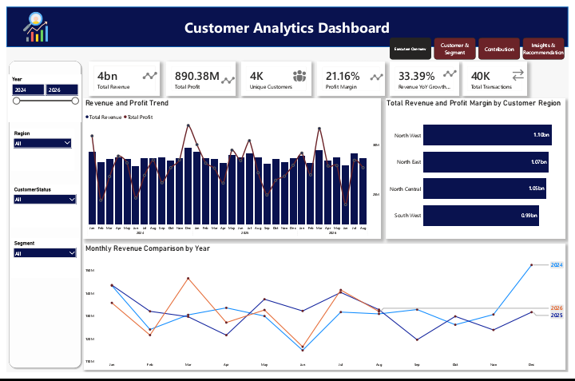

# SCA-TDD3-CAPSTONE-POWERBI-PROJECT: Customer Analytics

## Project Overview
This project analyses customer performance to understand which customer segments and regions contribute most to revenue and profit, how customer contribution changes over time and whether revenue is concentrated among a small number of customers.

## Business Questions
The project focuses on four main questions:

1. Which customer segments contribute most to revenue and profit?
2. Which customer regions contribute most to revenue and profit?
3. How concentrated are revenue and profit among customers and segments?
4. How does customer contribution change over time?

## Dataset

The project uses transactional sales data supported by customer, product, branch and monthly target tables.

The main sales dataset contains 40,000 cleaned transactions and covers January 2024 to August 2026.

## Tools Used

Power BI
Power Query
DAX

## Data Preparation
The data was cleaned using Power Query. Key steps included removing duplicate sales records, handling missing discount values, checking data types and preparing the tables for modelling.

## Data Model
A star-schema model was created using fact and dimension tables, together with a dedicated Date table for time-intelligence analysis.

## Dashboard
The Power BI report provides interactive analysis of:

• Executive performance
• Customer segments
• Customer regions
• Customer status
• Customer contribution
• Customer concentration
• Revenue and profit trends
• Discount and transaction profitability

## Key Outcome
The analysis shows that revenue is broadly distributed across customers and segments, while the Top 10 customers contribute only a small share of total revenue. This indicates low customer concentration and provides opportunities to improve customer retention, segment strategies and regional performance.

## Files
Power BI report
Project documentation
Power Point Presentation Slide

## Dashboard Preview

### Overview Page

